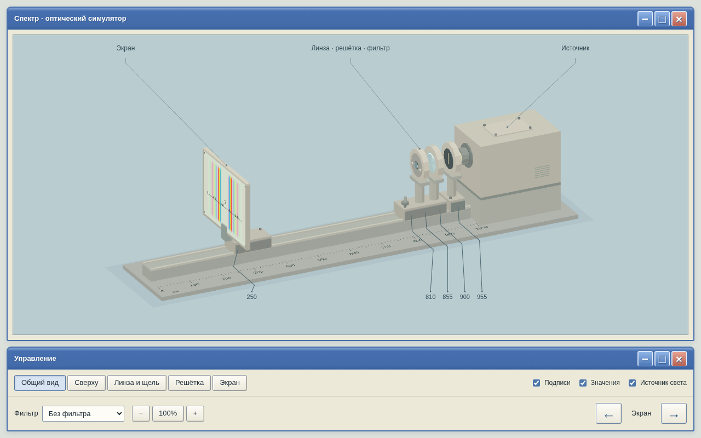

# Спектр

Симулятор оптической установки с оформлением Windows XP и графикой в стиле PlayStation. Можно двигать экран, менять фильтры, регулировать отверстие решётки и наблюдать спектр. Лабораторную программа за вас не выполняет.



## Запуск

Скачайте [spektr.html](dist/spektr.html) кнопкой **Download raw file** и откройте в браузере. Устанавливать ничего не нужно; после скачивания интернет не требуется.

Работа проверена в Chromium. Firefox, Safari и телефоны ещё не проверены. На телефоне открывайте файл в браузере, а не в просмотрщике вложений.

## Управление

Управление установкой находится в нижнем окне. Двигать можно только экран.

| Элемент | Что делает |
| --- | --- |
| Ракурс | Меняет точку обзора; для линзы со щелью, решётки и экрана есть отдельные виды |
| Источник света | Включает и выключает свет |
| Фильтр | Устанавливает красный или синий фильтр либо убирает его; фильтр действует на весь спектр, включая центр |
| Диаметр отверстия | Меняет рабочее отверстие решётки, но не её оправу и не расстояние между штрихами |
| Подписи | Показывает названия приборов |
| Значения | Показывает положения приборов и линейку на экране; работает отдельно от «Подписей» |

В видах «Общий вид» и «Сверху» экран можно перетаскивать мышью или пальцем с шагом 1 мм. Стрелки перемещают его по отметкам, кратным 10 мм: из 303 мм влево — на 300, вправо — на 310.

В виде «Экран» линейка показывает расстояние от центра до курсора. После касания она остаётся в выбранном месте. Для измерений также используйте шкалы на установке.

Кнопки масштаба, колесо мыши и жест двумя пальцами приближают или отдаляют изображение. Диапазон — 75–300%; кнопка сброса возвращает обычный размер. Увеличенный вид можно двигать за свободный фон.

Кнопки в заголовках сворачивают и разворачивают окна, не меняя настройку установки. Крестик показывает шутку, а не закрывает программу.

Браузер запоминает настройки, если это разрешено. При переносе файла на другое устройство настройки не переносятся.

## Состояние

Управление работает, цветовые переходы спектра плавные. Его яркость и форма пока приблизительные. Далее нужно уточнить расчёт спектра и размеры установки, проверить работу на телефонах.

[Параметры установки и вопросы преподавателю](docs/optics.md).

<details>
<summary>Разработка</summary>

Нужны Git, Node.js 20+ и доступ к репозиторию. Для подготовки выполните:

```sh
git clone https://github.com/BLXCKBXXST/spektr-optics.git
cd spektr-optics
npm ci
npx playwright install chromium
npm test
```

Код установки находится в `src/simulator.html`, расчёт спектра — в `src/spectrum.js`, кнопки окон — в `src/window-controls.js`. `src/shell.html` задаёт оформление страницы. Скрипт `scripts/build.cjs` собирает один HTML; `tests/` содержит тесты.

После изменений запустите `npm test`. Команда собирает HTML и проверяет работу программы. Сохраняйте обновлённый `dist/spektr.html` в Git вместе с исходниками. Результаты тестов в `test-results/` добавлять не нужно.

Для сборки без тестов используйте `npm run build`; установка пакетов не требуется. Если Chromium на Linux не запускается из-за недостающих библиотек, выполните `npx playwright install --with-deps chromium`.

</details>
